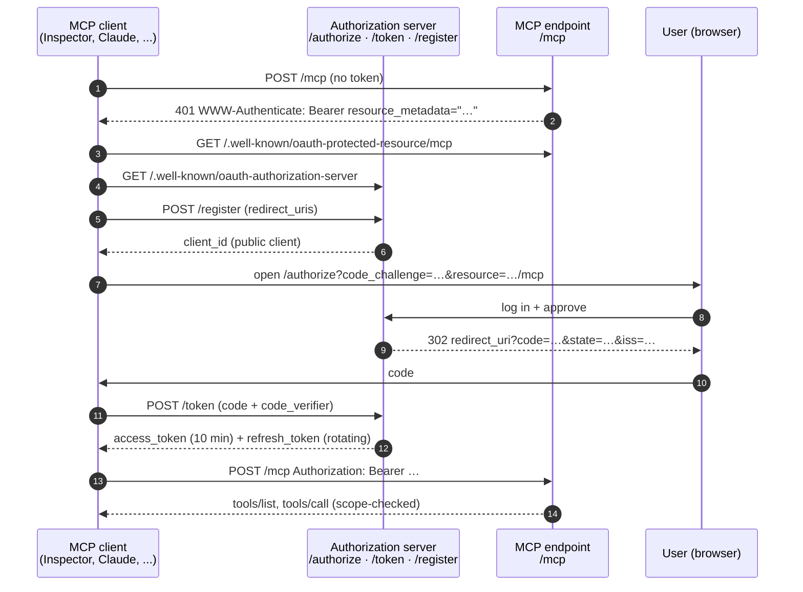

# mcp-oauth-starter

[](https://github.com/Kauazxz/mcp-oauth-starter/actions/workflows/ci.yml)
[](LICENSE)

**A remote MCP server protected by a spec-compliant OAuth 2.1 authorization server, in one small TypeScript codebase.**

About 1,000 lines of TypeScript (tests not counted) with three runtime dependencies besides the MCP SDK: Hono, `@hono/node-server` and zod.

## Why this exists

A remote [Model Context Protocol](https://modelcontextprotocol.io) server that holds user data needs authorization. The MCP spec builds on OAuth 2.1: discovery through RFC 9728 and RFC 8414, dynamic client registration (RFC 7591), PKCE, and audience-bound tokens (RFC 8707). Most examples stop at "plug in your identity provider". Writing the authorization server yourself means a lot of RFC reading, and the edge cases (code replay, refresh-token reuse, open redirects) are where real bugs hide.

This repository is a working reference you can read in an afternoon and fork: every endpoint an MCP client needs, the security checks a reviewer would ask about, and tests for each one, including an interoperability test that runs the full flow with the official MCP SDK client helpers.

## Architecture



Both roles live in the same process and share one store, which is what makes opaque access tokens practical (see [Security decisions](#security-decisions)).

```
src/
  server.ts     entry point (reads env, starts the HTTP server)
  app.ts        wires everything into one Hono app: CORS, security headers, routes
  config.ts     env parsing and validation (zod), supported scopes
  oauth.ts      authorization server: metadata, /register, /authorize, /token, token verification
  mcp.ts        /mcp: bearer auth, scope checks, MCP server with the three tools
  store.ts      OAuthStore interface + in-memory implementation
  notes.ts      per-user notes store used by the demo tools
  crypto.ts     random tokens, SHA-256, constant-time compare, PKCE verification
  rateLimit.ts  fixed-window in-memory rate limiter
  views.ts      server-rendered login/consent page (no client JavaScript)
test/           node:test suites, no network needed
```

## Quickstart

Requirements: Node.js 22.9 or newer.

```bash
git clone https://github.com/Kauazxz/mcp-oauth-starter.git
cd mcp-oauth-starter
npm install
cp .env.example .env          # then set DEMO_PASSWORD
npm run dev                   # http://localhost:3000
```

Production build:

```bash
npm run build
npm start
```

With Docker (multi-stage image, runs as the unprivileged `node` user):

```bash
docker build -t mcp-oauth-starter .
docker run --rm -p 3000:3000 \
  -e DEMO_USERNAME=demo -e DEMO_PASSWORD='change-me-please' \
  mcp-oauth-starter
```

Check that it is up:

```bash
curl http://localhost:3000/.well-known/oauth-authorization-server
curl -i -X POST http://localhost:3000/mcp   # 401 with a WWW-Authenticate challenge
```

### Configuration

All configuration comes from environment variables (see [`.env.example`](.env.example)). The server refuses to start if a required value is missing or invalid.

| Variable | Default | Notes |
| --- | --- | --- |
| `PORT` | `3000` | |
| `ISSUER_URL` | `http://localhost:$PORT` | Public origin, no path. Must be `https` unless it is localhost. The MCP endpoint is `$ISSUER_URL/mcp`. |
| `DEMO_USERNAME` / `DEMO_PASSWORD` | (required) | The single login accepted by the consent page. Password needs 8+ characters. |
| `ACCESS_TOKEN_TTL_SECONDS` | `600` | |
| `REFRESH_TOKEN_TTL_SECONDS` | `2592000` (30 days) | Each refresh issues a new refresh token with a fresh TTL. |
| `AUTH_CODE_TTL_SECONDS` | `60` | Max 600. |
| `RATE_LIMIT_PER_MINUTE` | `30` | Per IP, separately for `POST /register`, `POST /token` and `POST /authorize`. |
| `TRUST_PROXY` | `false` | Use the first `X-Forwarded-For` address as the client IP. Enable only behind a proxy you control. |

## Connecting an MCP client

### MCP Inspector (local)

1. Start the server with `npm run dev`.
2. In another terminal run `npx @modelcontextprotocol/inspector`.
3. In the Inspector UI choose the **Streamable HTTP** transport and enter `http://localhost:3000/mcp`.
4. Connect. The Inspector receives the 401, discovers the authorization server, registers itself and sends you to the login page. Its callback runs on `localhost`, which this server accepts over plain http (loopback only).
5. Log in with `DEMO_USERNAME` / `DEMO_PASSWORD` and click **Approve**.
6. Back in the Inspector, list the tools and call `create_note`, then `list_notes`.

### Claude (custom connector)

Claude connects from the internet, so the server needs a public HTTPS URL.

1. Expose the server, for example with a tunnel (`cloudflared tunnel --url http://localhost:3000` or `ngrok http 3000`), or deploy the Docker image.
2. Set `ISSUER_URL` to that public origin (for example `https://abc123.trycloudflare.com`) and restart. The issuer in the metadata must match the URL clients see.
3. In Claude, add a custom connector (Settings → Connectors) with the URL `https://<your-host>/mcp`.
4. Claude opens the consent page; log in and approve. The three note tools then show up in the connector.

The client flows above follow the published discovery and registration steps; the automated tests exercise the same flow with the official SDK client helpers, but there is no automated test against these two apps.

## Endpoints

| Method | Path | Spec | Purpose |
| --- | --- | --- | --- |
| GET | `/.well-known/oauth-protected-resource/mcp` | RFC 9728 | Protected resource metadata (also served at `/.well-known/oauth-protected-resource`) |
| GET | `/.well-known/oauth-authorization-server` | RFC 8414 | Authorization server metadata |
| POST | `/register` | RFC 7591 | Dynamic client registration (public clients only) |
| GET | `/authorize` | OAuth 2.1 §4.1 | Validates the request and renders the login and consent page |
| POST | `/authorize` | OAuth 2.1 §4.1 | Handles the login form, then redirects with `code`, `state` and `iss` |
| POST | `/token` | OAuth 2.1 §3.2 | `authorization_code` and `refresh_token` grants |
| POST | `/mcp` | MCP Streamable HTTP | JSON-RPC endpoint; requires `Authorization: Bearer` |
| GET, DELETE | `/mcp` | MCP Streamable HTTP | `405`: stateless server, no SSE stream or sessions |
| GET | `/healthz` | | Liveness check |

### Tools

| Tool | Scope | Input |
| --- | --- | --- |
| `create_note` | `notes:write` | `title`, `body` |
| `list_notes` | `notes:read` | none |
| `search_notes` | `notes:read` | `query` (case-insensitive substring) |

Notes are kept in memory, per user. A `tools/call` for a tool whose scope is missing from the token gets an HTTP `403` with `WWW-Authenticate: Bearer error="insufficient_scope", scope="notes:write"`, so clients that support step-up authorization know what to ask for. The tool handlers check the scope again as a second line of defense.

## Security decisions

**Opaque access tokens, not JWTs.** Access tokens are 256-bit random strings (`mcp_at_…`), and only their SHA-256 hash is stored. The authorization server and the MCP endpoint run in the same process and share the store, so validation is a single lookup, and the main benefit of JWTs (validation without calling the issuer) does not apply. In exchange, revocation takes effect immediately: when refresh-token reuse is detected, the access tokens of that grant stop working on the next request instead of living until `exp`. There are also no signing keys to generate, rotate or leak. If you split the resource server out to another service, signed JWTs (for example with `jose`) or RFC 7662 introspection become the better choice; that is on the roadmap.

**Hashes only.** Authorization codes, access tokens and refresh tokens are stored as SHA-256 digests. A dump of the store does not contain usable credentials. Tokens are 256-bit random values, so a fast unsalted hash is enough (no password hashing needed). Token prefixes (`mcp_at_`, `mcp_rt_`) make leaked tokens easy to spot and to add to secret scanners.

**PKCE everywhere, S256 only.** `code_challenge` is required for every client, and `code_challenge_method` must be `S256`. `plain`, or no method at all, is rejected. The metadata advertises only `S256`.

**No open redirects.** Until `client_id` is known and `redirect_uri` exactly matches one of the registered URIs (plain string comparison), errors are shown on an HTML page and never redirected. Registration accepts only `https` URIs, or `http` on loopback hosts, and rejects fragments and embedded credentials. Loopback ports are matched exactly too, which is stricter than RFC 8252 §7.3 suggests for native apps; register the exact callback URL.

**Single-use, short-lived codes.** Codes live 60 seconds by default and are marked used atomically by the first exchange attempt, so a failed attempt (wrong PKCE verifier, wrong `redirect_uri`) also burns the code. If a used code is presented again, the server assumes it leaked and revokes every token issued from it (OAuth 2.1 §4.1.3).

**Refresh-token rotation with reuse detection.** Every refresh returns a new refresh token and invalidates the old one. All tokens descending from one authorization share a *family id*. Presenting an already-rotated refresh token revokes the whole family, access tokens included, because the server cannot tell whether the attacker or the legitimate client is making the call. A request with an invalid `scope` or `resource` is rejected before the token is consumed, so a malformed request does not burn it. Trade-off: there is no grace period, so a client that sends two refreshes in parallel with the same token will lose its grant.

**Audience binding (RFC 8707).** The `resource` parameter is validated at `/authorize` and `/token` and stored with the grant. Only this server's MCP endpoint is accepted; `/mcp` rejects tokens bound to any other resource. A request without `resource` is bound to this server's MCP endpoint by default.

**Mix-up protection (RFC 9207).** The authorization response carries `iss`, and the metadata announces `authorization_response_iss_parameter_supported`.

**Constant-time comparisons.** The demo credentials and the PKCE check use `crypto.timingSafeEqual` on SHA-256 digests, so neither content nor length leaks through timing. Username and password are always both compared. Token lookups go through a hash-keyed map, so the attacker never controls a byte-by-byte comparison against a secret.

**Rate limiting and brute-force limits.** `POST /register`, `POST /token` and the login form are rate-limited per IP (in memory). Each pending authorization request also allows at most 5 wrong passwords before it is cancelled with `access_denied`.

**Consent page hardening.** The page is server-rendered with all values HTML-escaped and no JavaScript. It is served with a strict `Content-Security-Policy` (`default-src 'none'`, `frame-ancestors 'none'`, `form-action` limited to this origin and the client's redirect origin), `X-Frame-Options: DENY` and `Cache-Control: no-store`. The form only carries an unguessable request id, and the validated parameters stay on the server, so they cannot be changed between the GET and the POST. There is no login session cookie: every authorization asks for the credentials, so there is no session to abuse with CSRF.

**CORS.** Discovery, `/register`, `/token` and `/mcp` allow any origin, because browser-based clients such as MCP Inspector call them directly and no cookies are involved. `/authorize` is a top-level navigation and does not send CORS headers.

**No secrets in code.** Credentials come only from the environment. The server will not start without them, and `ISSUER_URL` must be https outside localhost.

### Known limitations

These are deliberate scope cuts for a starter, not hidden features:

- **Single process, in-memory state.** Clients, tokens, notes and rate-limit counters are lost on restart and not shared between replicas.
- **One demo user** from the environment instead of a real identity provider or user database.
- **Public clients only.** Registration always returns `token_endpoint_auth_method: "none"`; there are no client secrets. Registered clients never expire.
- **No token revocation (RFC 7009) or introspection (RFC 7662) endpoints.**
- **Refresh tokens have a sliding lifetime.** Each rotation starts a new TTL; there is no absolute maximum session length.
- **No `Origin` header validation on `/mcp`.** The MCP transport spec asks servers to validate `Origin` against DNS rebinding. Every request here needs a bearer token that a rebinding page cannot obtain, but an allow-list is still on the roadmap.
- **Stateless MCP transport with JSON responses.** No sessions, no SSE stream, so no server-to-client notifications.
- **No remembered consent.** The user logs in on every authorization.

## Testing

```bash
npm test            # node:test + tsx, fully offline
npm run typecheck
npm run lint
```

29 tests in 10 suites, all running in-process against `app.fetch` with an injectable clock (no network, no sleeps):

- **Discovery:** both metadata documents parse with the MCP SDK's own zod schemas.
- **Registration:** public client issued, unsafe redirect URIs rejected, rate limit returns `429` with `Retry-After` and recovers after the window.
- **Authorization endpoint:** an unregistered `redirect_uri` gets an error page and no redirect; `plain` or missing PKCE values are rejected; unknown scopes give `invalid_scope` and foreign resources `invalid_target`; a wrong password re-prompts; deny redirects with `access_denied` and the original `state`; approval returns `code`, `state` and `iss`; framing protection headers are present.
- **Token endpoint (code):** PKCE success and failure, `redirect_uri` mismatch, a code presented by another client, expiry after 60 s, duplicated parameters, and code replay, which also revokes the tokens of the first exchange.
- **Token endpoint (refresh):** rotation, reuse detection that kills the whole family (including the newest legitimate pair) without touching other grants, down-scoping allowed and up-scoping refused, a token presented by another client.
- **MCP endpoint:** `401` plus `WWW-Authenticate` (`resource_metadata`, `scope`) without a token, `invalid_token` for unknown or expired tokens, create/list/search through the official MCP `Client`, `403 insufficient_scope` for a read-only token calling `create_note`.
- **Interoperability:** discovery, registration, authorization URL, code exchange and a tool call driven entirely by the SDK's client OAuth helpers (`discoverOAuthServerInfo`, `registerClient`, `startAuthorization`, `exchangeAuthorization`).
- **Config and crypto:** issuer validation, required secrets, the RFC 7636 appendix B PKCE vector.

CI (`.github/workflows/ci.yml`) runs install, typecheck, lint, tests and build, then builds the Docker image.

## Roadmap

- SQLite and Postgres adapters for `OAuthStore` (the interface already describes the atomic "mark used" update they need).
- Delegate login to an upstream OpenID Connect provider (Google, GitHub, Auth0) instead of the demo user.
- Token revocation (RFC 7009) and an optional JWT access-token mode for a separately deployed resource server.
- Client ID Metadata Documents as an alternative to dynamic registration, as described in newer MCP authorization spec revisions.
- `Origin` allow-list for `/mcp`, and a shared (Redis) rate limiter for multi-instance deployments.
- Remembered consent per client, with a page to review and revoke it.

## License

[MIT](LICENSE) © 2026 Kauã Araujo de Souza
